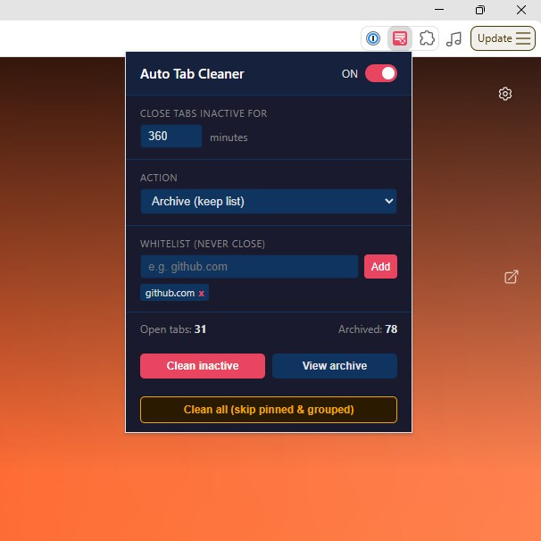

# Chrome Extensions

## auto-tab-cleaner

Automatically closes or archives browser tabs that have been inactive for a configurable period of time.

## Screenshot

### Installation

**Option A - from ZIP (easiest)**

1. Download `auto-tab-cleaner.zip` and unzip it to any folder
2. Open Chrome and go to `chrome://extensions/`
3. Enable **Developer mode** (toggle in top-right corner)
4. Click **Load unpacked**
5. Select the unzipped `auto-tab-cleaner` folder
6. Pin the extension icon in the toolbar for easy access

**Option B - from source (git clone)**

1. Clone this repository
2. Follow steps 2-6 from Option A, selecting the `auto-tab-cleaner` subfolder

> Note: Chrome may show a warning about Developer mode extensions on startup - this is normal for manually installed extensions.

### Usage

Click the extension icon to open the popup panel.

#### Enable / Disable

The toggle in the top-right corner of the popup turns the automatic cleaner on or off. The label shows the current state (ON / OFF). Settings are saved immediately.

#### Settings

| Setting | Description | Default |
|---|---|---|
| **Close tabs inactive for** | Inactivity threshold in minutes | 60 min |
| **Action** | What to do with stale tabs | Archive |

**Action options:**
- **Close (no history)** - tabs are permanently closed, no record kept
- **Archive (keep list)** - tabs are closed but saved to an archive list; you can reopen them later

#### Whitelist

Domains added to the whitelist are never closed, regardless of inactivity.

- Enter a domain (e.g. `github.com`) or a full URL - the extension extracts the hostname automatically
- Press **Add** or hit Enter
- Remove an entry by clicking the **x** on its tag

#### Buttons

| Button | Description |
|---|---|
| **Clean inactive** | Immediately runs the cleaner - closes/archives all tabs that exceed the inactivity threshold |
| **View archive** | Expands the archive panel showing all saved tabs; includes a search box |
| **Clean all (skip pinned & grouped)** | Closes all eligible tabs regardless of their last access time - useful for a manual session reset |

### Behavior

- The cleaner runs automatically every **5 minutes** in the background
- The following tabs are **never** touched:
  - Pinned tabs
  - Tabs in a tab group
  - The currently active tab in each window
  - `chrome://` and `brave://` internal pages
  - Domains on the whitelist
- Inactivity is measured from the last time the tab was activated (focused)
- Archive stores the last **500** entries; older entries are dropped automatically
- A browser notification is shown each time tabs are cleaned

### Stats

The bottom bar of the popup shows:
- **Open tabs** - total number of open tabs across all windows
- **Archived** - number of entries currently in the archive

### Archive

Click **View archive** to expand the list of saved tabs. Each entry shows the page title, favicon, and how long ago it was archived. Click any title to reopen the page in a new tab. Use the search box to filter by title or URL. **Clear all** removes the entire archive.
