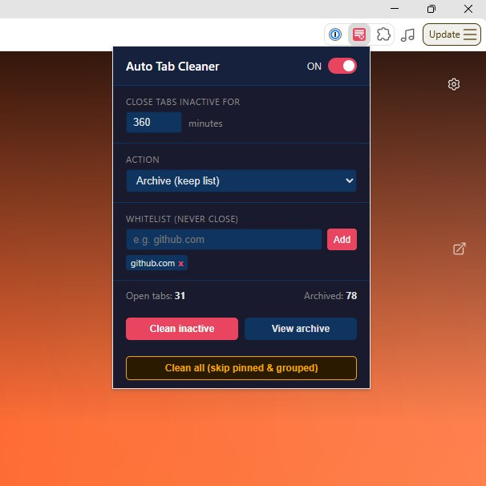

# Auto Tab Cleaner

Automatically closes or archives browser tabs that have been inactive for a configurable period of time.

## Installation

See the [general installation steps](../README.md#installation) and select the `auto-tab-cleaner` folder.

Permissions used: `tabs`, `tabGroups`, `storage`, `alarms`, `notifications`.

## Usage

Click the extension icon to open the popup panel.

### Enable / Disable

The toggle in the top-right corner of the popup turns the automatic cleaner on or off. The label shows the current state (ON / OFF). Settings are saved immediately.

### Settings

| Setting | Description | Default |
|---|---|---|
| **Close tabs inactive for** | Inactivity threshold in minutes | 60 min |
| **Action** | What to do with stale tabs | Archive |

**Action options:**
- **Close (no history)** - tabs are permanently closed, no record kept
- **Archive (keep list)** - tabs are closed but saved to an archive list; you can reopen them later

### Whitelist

Domains added to the whitelist are never closed, regardless of inactivity.

- Enter a domain (e.g. `github.com`) or a full URL - the extension extracts the hostname automatically
- Press **Add** or hit Enter
- Remove an entry by clicking the **x** on its tag

### Buttons

| Button | Description |
|---|---|
| **Clean inactive** | Immediately runs the cleaner - closes/archives all tabs that exceed the inactivity threshold |
| **View archive** | Expands the archive panel showing all saved tabs; includes a search box |
| **Clean all (skip pinned & grouped)** | Closes all eligible tabs regardless of their last access time - useful for a manual session reset |

## Behavior

- The cleaner runs automatically every **5 minutes** in the background
- The following tabs are **never** touched:
  - Pinned tabs
  - Tabs in a tab group
  - The currently active tab in each window
  - `chrome://` and `brave://` internal pages
  - Domains on the whitelist
- Inactivity is measured from the last time the tab was activated (focused)
- A browser notification is shown each time tabs are cleaned

## Stats

The bottom bar of the popup shows:
- **Open tabs** - total number of open tabs across all windows
- **Archived** - number of entries currently in the archive

## Archive

Click **View archive** to expand the list of saved tabs. Each entry shows the page title, favicon, and how long ago it was archived. Click any title to reopen the page in a new tab. Use the search box to filter by title or URL.

| Button | Description |
|---|---|
| **CSV** | Downloads the whole archive as `archived-tabs-YYYY-MM-DD.csv` |
| **JSON** | Downloads the whole archive as `archived-tabs-YYYY-MM-DD.json` |
| **Clear all** | Removes the entire archive |

### Export format

Both formats contain the title, URL and archive date of every entry (the search filter is ignored).

- **CSV** - columns `Title,URL,Archived At`; the date is in local time (`YYYY-MM-DD HH:MM:SS`). The file is UTF-8 with BOM so Excel shows non-ASCII characters correctly. Excel with a locale that uses `;` as the list separator may put everything in one column - use *Data → From Text/CSV* to import it.
- **JSON** - array of `{ "title", "url", "archivedAt" }`; `archivedAt` is an ISO 8601 UTC timestamp.

### Storage and limits

- The archive is kept in `chrome.storage.local` (key `archive`) - it survives browser restarts and is removed only by **Clear all**, uninstalling the extension or clearing profile data
- Only the last **500** entries are kept; older entries are dropped automatically
